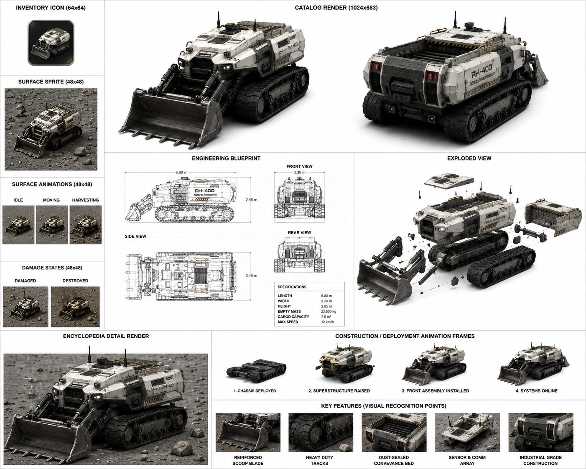

> **Wiki section:** UI & Experience · **Status:** design intent — established direction; detailed schemas, generation tooling, and presentation remain OPEN  
> **Last Updated:** 2026-11-21

# Catalog, Blueprint & Visual Asset Architecture

This page records the Player-facing Catalog and Blueprint experience and the intended blueprint-driven visual asset system. It complements the three primary Player views (Planetary, Surface, Settlement) and the separate Space context; it does not add another world-view level.

## Purpose and relationship

**ESTABLISHED DIRECTION — 2026-11-21**

Catalog and Blueprint are related, distinct Player interfaces:

- **Catalog:** helps players discover, browse, compare, and inspect game objects—units, vehicles, craft, structures, equipment, components, and other buildable or usable objects. It answers: *What is this object, what does it do, and what options exist?*
- **Blueprint:** presents the technical and manufacturing definition of an object. Depending on the object and available data, this can include dimensions, specifications, materials and quantities, component/assembly breakdown, production facilities and processes, research or technology dependencies, and construction requirements. It answers: *How is this object defined and built?*

Players should be able to investigate an object without first understanding the entire technology or manufacturing tree. Discovery/knowledge, research eligibility, manufacturing capability, and current availability are related but distinct; exact unlock and access rules remain OPEN.

Catalog and Blueprint are not subordinate to Planetary, Surface, or Settlement. They are cross-cutting Player tools that can be opened while planning, researching, managing industry, or inspecting an object in the world. A contextual link from a deployed unit should preserve the connection to that particular instance while allowing the player to inspect its general Catalog entry and Blueprint.

## Primary visual reference: complete RH-400 asset concept sheet

**ESTABLISHED VISUAL TARGET — 2026-11-21**

The RH-400 complete concept sheet below is the primary visual reference for the breadth and coordinated nature of the visual assets GalaxyGame aims to produce for a blueprint-defined object.

*Target example: one object identity represented through a coordinated package of catalog and encyclopedia imagery, engineering views, exploded component/assembly illustrations, inventory icon, surface sprite and animations, damage states, and construction/deployment stages. The sheet demonstrates the intended range of visual deliverables; it is not an authoritative engineering specification or proof that every representation is already generated or implemented.*

The RH-400 sheet is not merely a catalog render or an isolated illustration. It expresses the major categories of visual representation sought for GalaxyGame objects. It should be used as the principal example when developing and evaluating the Visual Bible, visual definitions, generation prompts, and asset-generation workflow.

## Blueprint-driven visual generation

**ESTABLISHED DIRECTION — 2026-11-21**

The intended workflow uses the authoritative object blueprint as the object-specific source data for image-generation prompts, together with the Visual Bible and relevant visual-definition/profile and render-template rules.

The responsibilities are distinct:

- **Blueprint JSON:** authoritative object identity and engineering/gameplay definition—such as dimensions, materials, components, interfaces, and technical specifications where defined.
- **Operational-data JSON:** initial operational configuration and defaults associated with the object. It is not a substitute for the blueprint's engineering definition.
- **Visual Bible and generation standards:** define visual style, consistency, recognition, rendering conventions, view requirements, and prompt construction.
- **Visual definition/profile and prompt inputs:** translate the particular object's characteristics and the requested representation into generation instructions.
- **Generated visual assets:** provide the resulting images and visual representations for use throughout the game. They do not replace the authoritative blueprint, and generated technical illustrations must be checked against it.

The goal is a repeatable, prompt-driven process—not an independent improvisation for every image. Representations of the same object should preserve its defining geometry, proportions, materials, colors, markings, and recognizable features across views and scales, subject to the needs of each representation.

The RH-400 reference demonstrates a broad target package. It does not establish that every object must receive every asset type, that all assets can be generated in one pass, or that generated images are fabrication-ready CAD, meshes, or engineering documents. Asset scope and validation requirements may vary by object and intended use.

## One object identity, multiple coordinated representations

**ESTABLISHED DIRECTION — 2026-11-21**

A blueprint-defined object should have one identity associated with its coordinated visual representations. The same object may be presented differently according to the interface and task:

| Representation | Intended use |
|---|---|
| Catalog renderings / alternate views | Object discovery, comparison, and presentation |
| Engineering views and specifications | Technical inspection alongside the Blueprint |
| Exploded views and component illustrations | Understanding assemblies and component relationships |
| Inventory icon | Compact identification in inventories and lists |
| Surface sprite and animations | Representation of a unit moving or working on a planetary surface |
| Settlement-scale sprite or representation | Representation of the same unit within a settlement scene |
| Damage / condition states | Visual communication of an object's operational condition where suitable |
| Encyclopedia / operating-context imagery | Explanatory presentation of the object in use |
| Construction / deployment sequence | Illustration of assembly and deployment stages |

These are coordinated representations of the same object, not separate game objects or unrelated art assets. A representation may be shared by multiple interfaces where appropriate; Surface and Settlement may consume the same sprite or related scale-appropriate assets. Their exact rendering rules and asset variants remain OPEN.

Complex objects should be navigable through their component and assembly relationships where those relationships exist in the blueprint data. A player inspecting a spacecraft, for example, should be able to follow links to its modules, subassemblies, components, and their own Catalog/Blueprint information. The visual breakdown should reflect the defined assembly rather than inventing components.

## Deployed-unit inspection and operational condition

**ESTABLISHED DIRECTION — 2026-11-21**

The player should be able to inspect the actual condition and operating state of an individual deployed unit, not just its generic design. For example, selecting a deployed HRV-400 should provide access to its identity and appropriate visual representation, its Blueprint and technical definition, and its own current operational information.

The model's `operational_data` JSONB field holds flexible per-instance information. An instance is initialized from its corresponding operational-data JSON defaults and can evolve independently during operation. Depending on the unit and data available, it may include configuration, current operating state, runtime, damage/condition, component status, and maintenance tracking. This describes the intended information role; it does not claim that all these fields or maintenance/degradation behaviors are currently implemented.

The Player UI should expose relevant operational information through an individual-unit inspection/detail experience. Potential information includes:

- current status and operating mode;
- actual installed configuration and equipment;
- condition, damage, degraded systems, and component failures;
- accumulated runtime and usage;
- maintenance intervals, service due, and outstanding repairs;
- current workload, power use, storage, and other unit-specific readings where available.

The world views should also communicate appropriate high-level status. For example, Surface can show the unit's sprite as it moves or works across the terrain, and Settlement can show the same unit in the settlement environment. Selecting that representation should provide a path to inspect the particular deployed instance.

Keep these information sources distinct:

- **Catalog:** the general object and its capabilities.
- **Blueprint:** the designed definition and manufacturing requirements.
- **Operational-data defaults:** initial operational configuration for an instance.
- **Individual instance operational data:** that instance's actual configuration and evolving runtime condition.
- **World representation:** the appropriate visual form and status cue for the current view.

The UI should present the authoritative instance state rather than maintain a separate competing copy. The exact inspection layout, field schema, update/communications behavior, and history storage remain OPEN.

## Open details

- Catalog taxonomy, search/filtering, variants, comparison, and access/discovery rules.
- Exact relationship and navigation between Catalog entries, Blueprint definitions, components, and deployed instances.
- Visual Bible structure and the current status of the historical Engineering / Art / Manufacturing Bible proposal.
- Visual-definition schema, prompt assembly, generation orchestration, asset naming/storage, and association with object identities.
- Which representations are required or useful for each object class and how generated assets are validated.
- Sprite scale, animation states, damage-state mapping, and reuse between Surface and Settlement.
- Which operational-data values are currently implemented, which are future candidates, and how the Player UI should handle stale or unavailable information.

Do not treat the illustrative RH-400 sheet as proof of implementation, freeze unresolved schemas, or infer technical values from the concept image. Where historical documentation conflicts with current implementation, inspect the relevant code and tests first; then distinguish verified behavior, historical proposals, established intent, and unresolved design questions.
